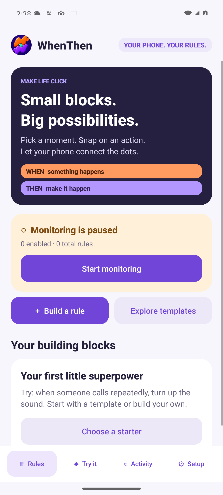
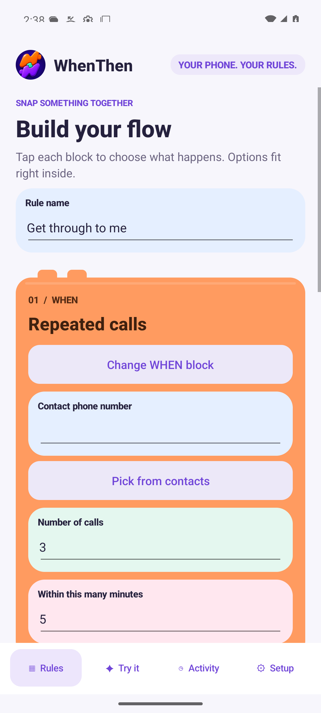
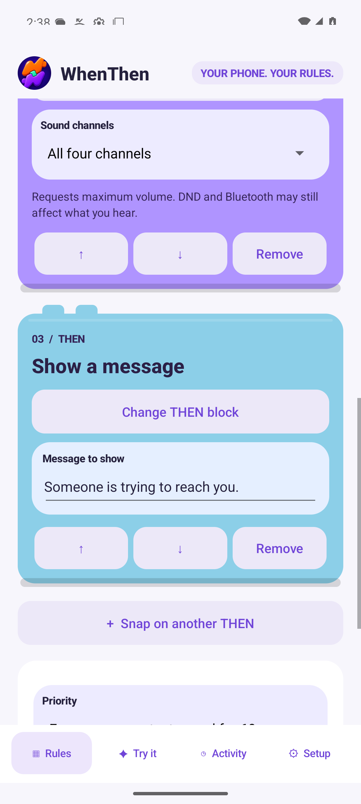

<p align="center">
  
</p>

# WhenThen

[](https://github.com/william-pyle/WhenThen/actions/workflows/build.yml)
[](https://github.com/william-pyle/WhenThen/actions/workflows/release.yml)
[](https://github.com/william-pyle/WhenThen/releases/latest)
[](https://github.com/william-pyle/WhenThen/releases)
[](LICENSE)
[](https://github.com/william-pyle/WhenThen/releases/latest)

**Make life click.**

WhenThen is a native Android automation app with colorful, interlocking **WHEN**, **THEN**, and option blocks. Choose an event, snap on one or more actions, and let your phone follow your rules.

Personal edition · Android **12 or later** · Java and Android Views

## What you can build

- **Snap together a flow.** One WHEN block and up to 20 ordered THEN blocks, with templates, duplication, validation, and accessible move controls.
- **React to calls, texts, places, and Wi-Fi.** Nine trigger types cover incoming, missed, and repeated calls; incoming and exact-match SMS; place entry and exit; and connection to or disconnection from a named Wi-Fi network.
- **Choose from eight actions.** Mute, restore sound, set volume, use emergency loud, play an audio file, show a message or image notification, or send an SMS.
- **Try before you enable.** Simulation uses the real rule matcher and previews actions without sending texts, changing volume, displaying action notifications, or playing audio.
- **See when monitoring is active.** A user-started foreground session has an ongoing notification, permission checks, Stop controls, and a resume prompt after an interruption.

For example: **WHEN** a chosen contact calls three times within five minutes, **THEN** turn up the sound and show a message.

## Inside the app

| Your rules | Build a WHEN | Add THEN actions |
| --- | --- | --- |
|  |  |  |

These are screenshots of the native Android app.

## Download and install

**[Download the latest signed APK](https://github.com/william-pyle/WhenThen/releases/latest/download/WhenThen.apk)** ? [Release notes and older versions](https://github.com/william-pyle/WhenThen/releases)

Download `WhenThen.apk` directly on your phone. You do not need Android Studio, a computer, or a GitHub account to try the app. This is a personal APK distribution, outside Google Play. Android 12 or newer is required.

1. Copy the APK to your phone and open it. Android may ask you to allow installation from that browser or file manager.
2. Open **WhenThen → Setup** and grant the permissions needed by your chosen rules. Installer restrictions can make SMS or call-log access unavailable; the app reports missing access.
3. Set battery access to unrestricted. On Samsung devices, add WhenThen to **Never sleeping apps**; menu names vary by One UI version.
4. Choose a template or **Build a rule**, configure its options, and add THEN blocks. Save, simulate, then enable the rule.
5. Tap **Start monitoring** while the app is visible. After a reboot, force-stop, or interruption, open the app and restart monitoring.

## Updating WhenThen

When you open WhenThen, it checks for a completed stable GitHub release, at most once every 15 minutes. If a newer version is ready, choose **Update now** or **Later**. Later postpones that version for 24 hours; **Setup ? Check for updates** checks immediately whenever you want.

The first time you update, Android asks you to allow installation from WhenThen. Enable **Allow from this source** for WhenThen and return to the app. The download is checked against its checksum, application ID, version, and signing certificate before Android asks you to confirm installation.

Updates retain your saved rules. Reopen the app afterward and tap **Start monitoring** if needed. Downloads and checks do not activate rules, send messages, or play audio. An unavailable network leaves the app usable; a failed or cancelled update keeps the installed version.

For an initial trial, open **Try it** and simulate a rule before enabling it. Grant permissions only for the events and actions you intend to use. Android or your installer may restrict SMS and call-log access, and the app will show those missing capabilities.

## Private by default

Rules, readiness observations, and the latest 300 history entries stay on the phone. There is no account or analytics. Internet access is used to check GitHub releases and download updates; the updater never uploads your rules, contacts, message text, or location. JSON backup and restore use Android's file picker. Exported backups can contain private phone numbers and message text, so keep them private.

## How the blocks behave

- New, edited, and imported rules start **paused**. Changing rules pauses monitoring; start it again to apply the configuration.
- SMS text matching is exact and case-sensitive, including spaces. SMS support does not include RCS or third-party messaging apps.
- Repeated-call rules count distinct incoming calls, including answered calls. They fire at the threshold and rearm after the rolling count falls below it.
- Wi-Fi and place monitoring establish an initial baseline without firing. Wi-Fi disconnects allow a short roaming grace period; internet loss alone is not a Wi-Fi disconnect.
- Place rules default to a **250-foot radius** and require two accurate observations at least ten seconds apart. Stale or imprecise locations are ignored.
- Actions are dispatched in list order. Audio continues while later actions run; another audio action replaces the current sound. Playback is limited to **1–300 seconds**.
- Emergency sound actions protect volume and playback from normal-priority changes for 60 seconds. Do Not Disturb and audio routing still apply.
- Outgoing SMS is limited to one message per rule/recipient every five minutes and ten messages per hour across the app. It uses the configured or default SMS SIM; unknown sends are not automatically retried.
- Import replaces the rule collection after confirmation and leaves it paused. Select media files again when moving to another phone.

## Tested status

The original 1.0.0 release was checked on November 6, 2026:

| Area | Recorded result |
| --- | --- |
| Rule engine | 29 unit tests passed: validation, matching, deduplication, rolling counts, cooldowns, location confirmation, priority, and persistence. |
| Builds and static analysis | Debug and signed release APKs built; Android lint reported no errors, with advisory warnings recorded. |
| Native UI and runtime | 23 emulator tests passed; the physical-device audio test was skipped on the emulator. |
| Android event integrations | All nine triggers passed with emulator call, SMS, Wi-Fi, and GPS inputs. |
| Galaxy S24 Ultra, Android 17 / API 37, One UI 9 | Installation, layout, notifications, screen-off monitoring, audio playback, volume read-back, and restoration checked. The tester confirmed hearing the locked-screen diagnostic tone. |

The current build includes unit tests for the rule engine and update validation, emulator tests for the update dialogs and permissions, and release archive exclusion checks. The original full phone-event checks above are not a guarantee for every device or emergency scenario.

**Real-world testing remains incomplete:** live carrier calls and SMS send/delivery, physical GPS crossings, DND/Bluetooth combinations, extended idle, and Samsung recovery behavior still need verification. The locked-screen audio check used a diagnostic event, not a carrier-delivered SMS. These results do not establish reliability for every emergency scenario; test the actual rules and conditions you intend to use.

## Build from source

Open this repository root in Android Studio, or use the command line with:

- JDK **17**
- Android SDK platform **36**, Build Tools **35.0.0**, and Platform Tools
- Gradle **8.13**, supplied by the checked-in wrapper

The app ID is `com.jazcosolutions.whenthen`. The version is defined in `version.properties`; minimum SDK is 31 and target/compile SDK is 36.

Set `JAVA_HOME` and `ANDROID_HOME` to your local installations. From the repository root on Windows:

```powershell
powershell -ExecutionPolicy Bypass -File scripts/build-android.ps1
```

This builds a debug APK, runs the unit tests, and runs lint. The output is:

```text
app/build/outputs/apk/debug/app-debug.apk
```

Or use the wrapper directly:

```powershell
.\gradlew.bat assembleDebug testDebugUnitTest lintDebug
```

On macOS or Linux, use `./gradlew assembleDebug testDebugUnitTest lintDebug` from the repository root.

### Optional isolated Windows toolchain

The included bootstrap keeps tools under ignored `.local/tools/` and makes no global PATH changes. Python 3 is required.

```powershell
python scripts/setup-tools.py
$whenTools = Join-Path (Get-Location) '.local/tools'
$env:JAVA_HOME = (Get-ChildItem "$whenTools/java" -Directory | Select-Object -First 1).FullName
& "$whenTools/sdk/cmdline-tools/19.0/bin/sdkmanager.bat" "--sdk_root=$whenTools/sdk" --licenses
& "$whenTools/sdk/cmdline-tools/19.0/bin/sdkmanager.bat" "--sdk_root=$whenTools/sdk" "platform-tools" "platforms;android-36" "build-tools;35.0.0"
powershell -ExecutionPolicy Bypass -File scripts/build-android.ps1
```

### Release signing and packaging

Private signing material is excluded. Android updates require the same application ID and signing key as the installed app. Keep both consistent for your distribution.

For your own distribution, after setting up the isolated toolchain, create your own key once and build a release:

```powershell
python scripts/create-signing-key.py
& ./scripts/build-android.ps1 -Tasks assembleRelease
python scripts/package-release.py
```

The key and `signing.properties` stay under ignored `.local/tools/`. Keep a secure backup. The packaging script writes the signed APK and a complete source ZIP to `dist/`.

### Tests

The default build runs host-side unit tests and lint without connecting to a phone. Instrumentation tests and the Python integration scripts under `tests/` are additional device tests. Emulator fixtures reset test rules and **must only run on an isolated emulator**. `DeviceSmokeTest` is a separate physical-device test that locks the screen and plays a tone; run it only in an explicitly authorized device-test session.

Check the release archive's source and private-file exclusions with `python tests/test-package-release.py`.

## Publishing a new version

GitHub builds, tests, signs, and attaches the APK automatically when you publish a stable release. Signing secrets are already configured for this repository; the private key is never committed.

1. Run `python scripts/set-version.py 1.0.2`, replacing `1.0.2` with your next version. This also increases Android's version code.
2. Commit and push the app changes and `version.properties` to `main`.
3. Open [Create a release](https://github.com/william-pyle/WhenThen/releases/new), create the matching tag (for example `v1.0.2`) from `main`, add release notes, and publish it as a stable release.
4. Wait for [Release APK](https://github.com/william-pyle/WhenThen/actions/workflows/release.yml) to finish successfully. `WhenThen.apk`, the source ZIP, checksums, and `update.json` will appear on the release. The app only offers an update after these files are ready.

A release is ready only when its workflow is green and the APK is attached. Versions without an updater need one manual installation of the updater-enabled APK first.

<details>
<summary>Release troubleshooting and signing-key backup</summary>

- **Version mismatch:** the tag must be `v` followed by the exact version in the tagged source's `version.properties`.
- **Tests fail:** fix the source, increase its version, and create a new release. Do not overwrite an already distributed version.
- **Temporary runner or network failure:** rerun the failed jobs, or select **Actions → Release APK → Run workflow** and enter the existing incomplete release tag.
- **Missing signing configuration:** check **Settings → Secrets and variables → Actions**. The required secret names are `ANDROID_KEYSTORE_BASE64`, `ANDROID_KEYSTORE_PASSWORD`, `ANDROID_KEY_ALIAS`, and `ANDROID_KEY_PASSWORD`. Never paste their values into a commit, issue, or log.
- **Release already complete:** publish a new version. The workflow refuses to replace a release that already contains `update.json`.

Keep a separate secure backup of the existing keystore and its passwords. GitHub secret values cannot be read back through the interface. Losing the signing identity prevents ordinary updates to existing installations.

This workflow attaches assets after release publication, so the repository's release immutability setting is currently disabled. Before enabling immutable releases, change the workflow to build and attach assets to a draft before publishing it.

</details>

## Repository layout

| Path | Contents |
| --- | --- |
| `app/` | Android app, resources, Java unit tests, and instrumentation tests |
| `gradle/`, `gradlew`, `gradlew.bat` | Gradle wrapper and build configuration |
| `scripts/` | Build, tool setup, signing-key creation, emulator download, and release packaging |
| `tests/` | Android emulator event and location integration scripts |
| `docs/images/` | App icon and native screenshots |
| `.github/workflows/` | Automatic build checks and signed release publishing |
| `version.properties` | App version and Android version code |

Generated builds, downloads, caches, local SDK paths, private signing material, and device data are excluded from Git.

## License

[MIT](LICENSE), as provided in this repository.
